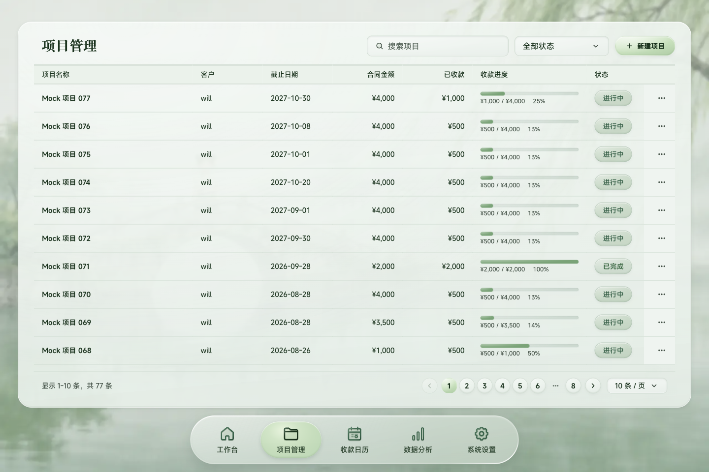
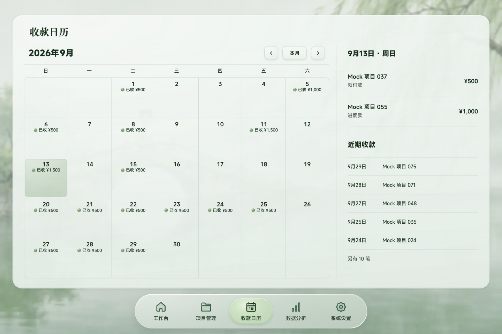
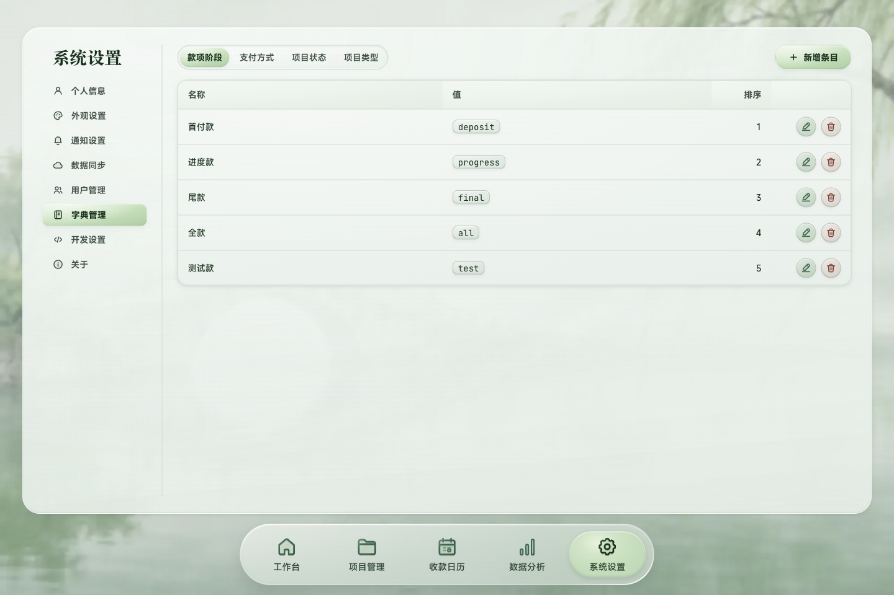
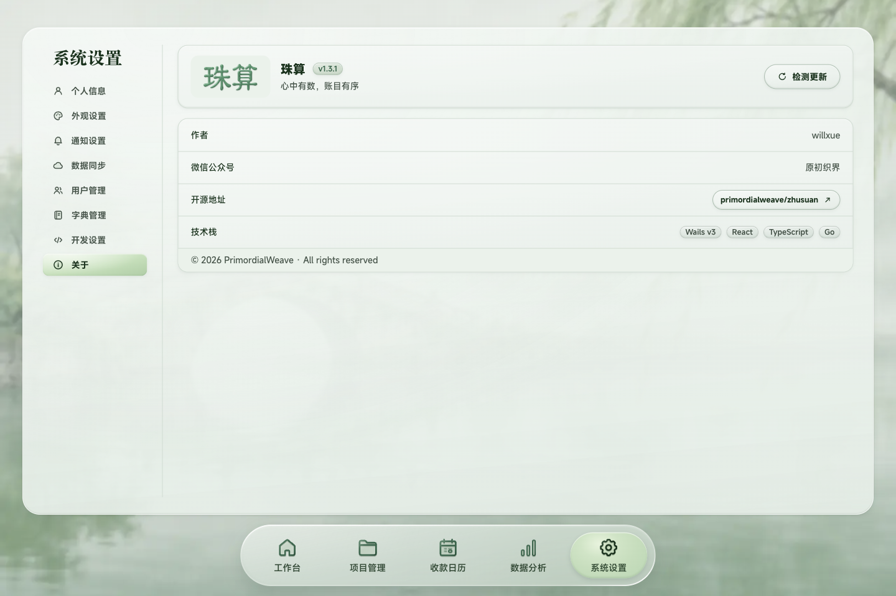
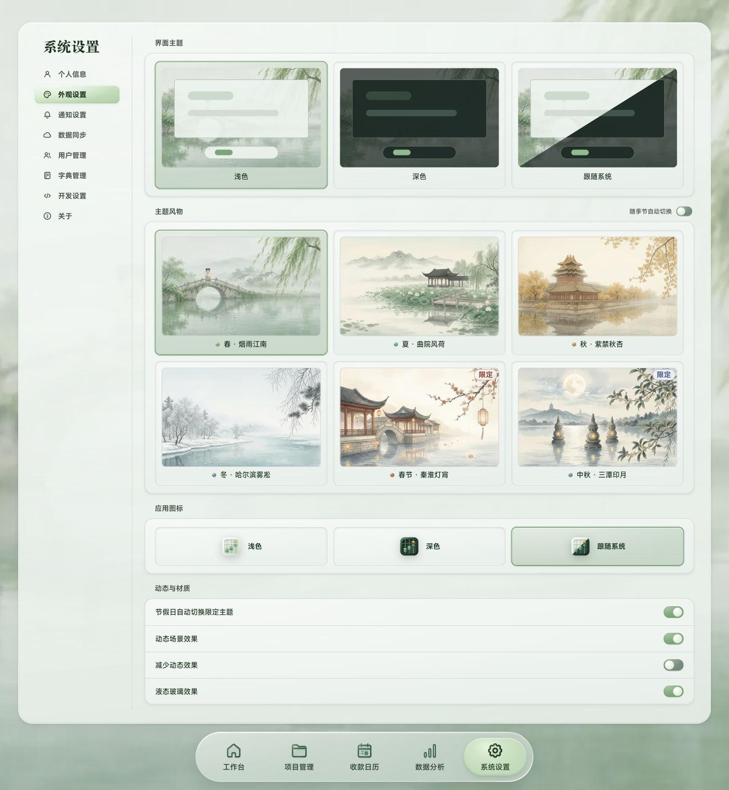

<div align="center">
  <picture>
    <source media="(prefers-color-scheme: dark)" srcset="docs/assets/readme-banner-dark.png" />
    <source media="(prefers-color-scheme: light)" srcset="docs/assets/readme-banner.png" />
    
  </picture>

  <p><strong>轻量、雅致的跨平台项目台账与收款管理桌面应用</strong></p>

  <p>
    <a href="https://github.com/primordialweave/zhusuan/releases/tag/v1.4.0">
      
    </a>
    
    
    
    <a href="LICENSE">
      
    </a>
  </p>

  <p>
    <a href="README_EN.md">English</a> ·
    <a href="https://github.com/primordialweave/zhusuan/releases/tag/v1.4.0">下载安装包</a> ·
    <a href="CHANGELOG.md">更新日志</a> ·
    <a href="docs/migration.md">迁移指南</a> ·
    <a href="docs/release.md">发布说明</a>
  </p>
</div>

---

## 核心功能

- **工作台**：点击切换全部、本年、本月签约合同，展示这批合同截至现在的已收与未收金额。
- **项目台账**：管理客户信息、合同金额、项目类型与交付节点，直观追踪回款完成度。
- **逐笔收款与日历**：项目可先创建，收到款后逐笔录入金额和实际到账日期，日历按到账日展示收款；保留历史计划记录。
- **数据分析**：按自然周 / 月 / 季 / 年及自选年月展示签约合同回款，实际到账金额与趋势独立统计，支持 CSV 导出。
- **系统管理**：内置个人资料、字典管理、用户权限、通知设置、云端数据同步与个性化外观偏好。
- **自定义主题**：六套四季与节庆风物，支持浅色 / 深色 / 跟随系统、随季节切换与节假日限定主题，场景和界面配色即时联动。
- **原生桌面体验**：支持菜单栏 / 系统托盘常驻、开机启动、全局快捷键、收款提醒与本地账本备份；macOS 提供速览浮窗，Windows / Linux 提供快捷操作入口。保留原生文件保存、系统凭据存储与应用内校验更新。

## 界面预览

| 工作台 | 项目管理 |
| --- | --- |
|  |  |
| **收款日历** | **数据分析** |
|  |  |
| **字典管理** | **关于** |
|  |  |

更多页面：[项目详情](docs/screenshots/project-detail.png) · [新建项目](docs/screenshots/project-create.png) · [登录页](docs/screenshots/login.png)

## 自定义主题

在 **设置 → 外观设置 → 主题风物** 中选择喜欢的风景，场景、界面与图表配色即时更新，无需重启。每套风物都可搭配浅色、深色或跟随系统模式。

| 风物 | 场景 | 动态效果 |
| --- | --- | --- |
| 春 · 烟雨江南 | 江南水乡 | 细雨、水波与柳枝 |
| 夏 · 曲院风荷 | 杭州西湖 | 萤火、荷叶与湖面 |
| 秋 · 紫禁秋杏 | 北京故宫角楼 | 银杏落叶与水波 |
| 冬 · 哈尔滨雾凇 | 松花江雾凇长堤 | 飘雪与薄雾 |
| 春节 · 秦淮灯宵 | 南京秦淮河 | 孔明灯与花灯暖光 |
| 中秋 · 三潭印月 | 杭州西湖 | 桂花与月华灯影 |

- **随季节自动切换**：根据本地日期切换春、夏、秋、冬风物，也可随时手动选择。
- **节假日限定主题**：开启后，春节与中秋期间自动应用对应风物；全年均可手动预览和选用。节庆期间手动选用四季风物，会跳过当年这一次节庆自动切换。
- **本地保存**：主题偏好保存在设备上，季节与节庆日期离线判断；动态场景、减少动态效果和液态玻璃可分别设置。



<picture>
  <source media="(prefers-color-scheme: dark)" srcset="docs/screenshots/themes-dark.jpg" />
  <source media="(prefers-color-scheme: light)" srcset="docs/screenshots/themes-light.jpg" />
  
</picture>

[浅色主题一览](docs/screenshots/themes-light.jpg) · [深色主题一览](docs/screenshots/themes-dark.jpg)

截图采集说明见[界面截图](docs/screenshots/README.md)。

## 下载安装

前往 [GitHub Releases](https://github.com/primordialweave/zhusuan/releases/tag/v1.4.0) 获取最新版 **v1.4.0** 安装包：

| 平台 | 安装包 | 说明 |
| --- | --- | --- |
| macOS (Apple Silicon) | [zhusuan-v1.4.0-macOS-arm64.dmg](https://github.com/primordialweave/zhusuan/releases/download/v1.4.0/zhusuan-v1.4.0-macOS-arm64.dmg) | 适用于 M 系列芯片，macOS 12+ |
| macOS (Intel) | [zhusuan-v1.4.0-macOS-amd64.dmg](https://github.com/primordialweave/zhusuan/releases/download/v1.4.0/zhusuan-v1.4.0-macOS-amd64.dmg) | 适用于 Intel 芯片，macOS 12+ |
| Windows (x64) | [zhusuan-v1.4.0-windows-amd64-installer.exe](https://github.com/primordialweave/zhusuan/releases/download/v1.4.0/zhusuan-v1.4.0-windows-amd64-installer.exe) | 安装向导（支持用户目录安装与升级） |
| Linux (x64) | [AppImage](https://github.com/primordialweave/zhusuan/releases/download/v1.4.0/zhusuan-v1.4.0-linux-x86_64.AppImage) · [.deb](https://github.com/primordialweave/zhusuan/releases/download/v1.4.0/zhusuan-v1.4.0-linux-amd64.deb) · [.rpm](https://github.com/primordialweave/zhusuan/releases/download/v1.4.0/zhusuan-v1.4.0-linux-amd64.rpm) | 桌面便携包与发行版安装包 |

> macOS 用户打开 DMG 后将「珠算」拖入 `Applications`，从应用程序文件夹启动即可。

## 技术栈

| 层级 | 技术方案 |
| --- | --- |
| 桌面容器 | Wails v3.1，系统原生 WebView |
| 后端服务 | Go 1.26、Gin、GORM、SQLite（默认）/ MySQL / PostgreSQL |
| 前端应用 | React 19、TypeScript、Vite 8、React Router、Zustand |
| 视觉系统 | ODS 设计系统与语义令牌、JadeIcon SVG 图标、Tailwind CSS 4、Chart.js |

## 快速开始

### 环境要求

- Go `1.26.10+`（推荐 `1.26.11`）
- Node.js `24+` 与 npm
- Wails CLI `v3.1.0`、Task `v3.54.0`
- Linux 桌面构建另需 GTK4 与 WebKitGTK 6.0 开发库

### 本地运行

```sh
git clone https://github.com/primordialweave/zhusuan.git
cd zhusuan
go install github.com/wailsapp/wails/v3/cmd/wails3@v3.1.0
go install github.com/go-task/task/v3/cmd/task@v3.54.0
cd frontend && npm ci && cd ..
task dev
```

### 常用命令

| 命令 | 说明 |
| --- | --- |
| `task dev` | 启动 Wails 桌面开发模式 |
| `task build` | 构建当前平台应用 |
| `task package` | 生成当前平台分发安装包 |
| `task darwin:package ARCH=arm64` | 构建指定架构 macOS DMG 与更新 ZIP（支持 `arm64` / `amd64`） |
| `task server:dev` | 启动独立 HTTP API 服务 |
| `task icons` | 从 `build/appicon.png` / `build/appicon-dark.png` 重新生成全平台图标 |

## 配置与数据目录

默认数据与配置目录为 `UserConfigDir/primordialweave/zhusuan`（数据库文件 `zhusuan.db`）：

- **macOS**：`~/Library/Application Support/primordialweave/zhusuan`
- **Windows**：`%APPDATA%\primordialweave\zhusuan`
- **Linux**：`~/.config/primordialweave/zhusuan`

首次初始化新数据库时会自动生成随机管理员密码，写入数据目录下的 `initial-credentials.txt`（`0600` 权限）。从旧版 Orange 升级的数据迁移规则请参阅 [迁移指南](docs/migration.md)。

可通过项目或配置目录下的 `.env` 自定义运行参数（参考 `.env.example`）：

| 环境变量 | 说明 |
| --- | --- |
| `DB_TYPE` / `DB_PATH` | 数据库类型（`sqlite` / `mysql` / `postgres`）及自定义路径 |
| `API_SERVER_PORT` | 独立后端服务端口 |
| `JWT_SECRET` | JWT 签名密钥（生产环境请配置强随机值） |
| `GITHUB_REPO` | 应用内更新检测仓库 |
| `APP_SLOGAN` | 关于页标语（默认 `心中有数，账目有序`，重启生效） |
| `APP_WECHAT_PUBLIC_ACCOUNT` | 关于页公众号名称（默认 `原初织界`，重启生效） |

## 测试与校验

```sh
# 前端检查与构建
cd frontend
node node_modules/eslint/bin/eslint.js src --max-warnings=0
npm run test:run
npm run build
cd ..

# 后端与工具脚本校验
ZHUSUAN_CONFIG_ROOT=/tmp/zhusuan-check go test -race . ./internal/... ./cmd/...
go vet . ./internal/... ./cmd/...
python3 -m unittest discover -s scripts -p "test_*.py"
```

## 贡献与许可证

欢迎提交 Issue 或 Pull Request，提交变更时请附带必要的测试与构建验证。本项目基于 [MIT 许可证](LICENSE) 开源。
