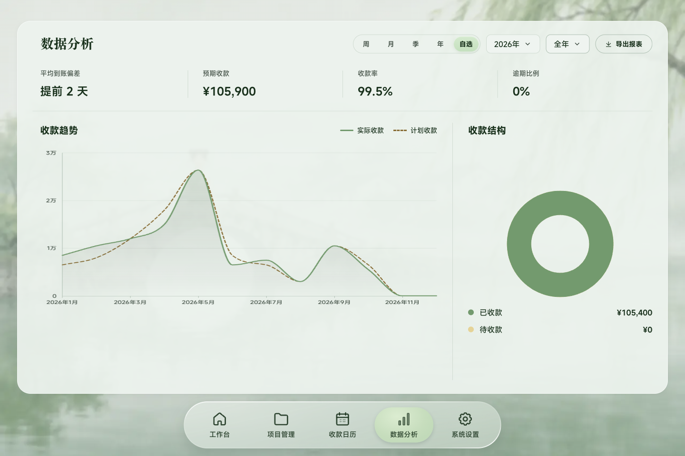

<div align="center">
  

# 珠算 · zhusuan

项目台账与收款管理桌面应用

[English](README_EN.md) · [更新记录](CHANGELOG.md) · [迁移说明](docs/migration.md) · [发布说明](docs/release.md)

</div>

珠算基于 Wails v3、Go 和 React 构建，管理项目合同、分期收款、待收与逾期款项。原 Orange 仓库已迁入 [Primordial Weave](https://github.com/primordialweave/zhusuan)，当前版本为 **1.0.0**。[下载安装包](https://github.com/primordialweave/zhusuan/releases/tag/v1.0.0)。

## 功能

- 工作台：切换全部、本年、本月收款摘要。
- 项目：维护客户、合同、项目类型和交付日期，查看回款进度。
- 收款：一次性与分期计划、确认到账、日历跟进。
- 分析：自然年/月或周期统计，项目表现与 CSV 导出。
- 设置：个人资料、字典、用户、通知、数据同步、外观偏好。
- 桌面能力：原生保存对话框、系统凭据存储、应用内下载校验与更新重启。
- 外观：烟雨/夜雨主题、青瓷算盘图标、可关闭动态与玻璃材质。

## 界面预览

以下为当前界面的脱敏截图。项目名称、客户、合同编号、人员与联系信息已打码，金额保留。截图来自隔离的数据库副本，原数据未修改。点击图片可查看完整尺寸。

| 工作台 | 项目管理 |
| --- | --- |
|  |  |
| 收款日历 | 数据分析 |
|  |  |
| 字典管理 | 关于 |
|  |  |

[项目详情](docs/screenshots/project-detail.png) · [新建项目](docs/screenshots/project-create.png) · [登录页](docs/screenshots/login.png)

## 技术栈

| 层 | 技术 |
| --- | --- |
| 桌面 | Wails v3.0.0-alpha.55，系统 WebView |
| 后端 | Go 1.26、Gin、GORM、SQLite/MySQL/PostgreSQL |
| 前端 | React 19、TypeScript、Vite 7、React Router、Zustand |
| 视觉 | ODS 组件与语义令牌、Tailwind 4、Chart.js、Remix Icon |

macOS、Windows、Linux 是当前发布工作流的目标。iOS/Android 保留构建脚手架与图标资产，尚未完成移动端发布验收。

## 本地开发

需要 Go 1.26、Node.js 24、npm 与固定版本 Wails/Task。前端兼容范围见 frontend/package.json。Linux 桌面构建还需要 GTK3/WebKit2GTK 4.1 开发库。

```sh
git clone https://github.com/primordialweave/zhusuan.git
cd zhusuan
go install github.com/wailsapp/wails/v3/cmd/wails3@v3.0.0-alpha.55
go install github.com/go-task/task/v3/cmd/task@v3.51.1
cd frontend && npm ci && cd ..
task dev
```

- `task build`：构建本机应用。
- `task package`：生成本机安装/分发包。
- `task server:dev`：启动独立 HTTP 服务。
- `task icons`：从 build/appicon.png 生成全部平台图标。

开发模式的普通 Vite 页面不包含 Wails API 代理。浏览器预览可运行独立后端，然后使用 frontend/vite.preview.config.mts；调试涉及写入时使用数据库副本。

## 数据与旧版升级

默认配置目录为 `UserConfigDir/primordialweave/zhusuan`，数据库为 `zhusuan.db`：

- macOS：`~/Library/Application Support/primordialweave/zhusuan`
- Windows：`%APPDATA%\primordialweave\zhusuan`
- Linux：`~/.config/primordialweave/zhusuan`

首次安装的新数据库会生成随机初始密码，保存于该目录的 `initial-credentials.txt`（0600权限）。不要把开发示例密码用于生产。

旧 Orange 默认数据库在首次启动时通过 SQLite 一致快照迁入新目录，原库保留，已有新库不覆盖。非空自定义 `DB_PATH` 继续使用原路径。Windows 安装器继承旧安装位置，完成安装后需要启动一次珠算；保存的登录信息与必要外观设置按新身份迁移。详见 [迁移说明](docs/migration.md)。

`.env` 可配置 `DB_TYPE`、`DB_PATH`、云端数据库连接、`API_SERVER_PORT`、`GITHUB_REPO` 和日志选项。生产环境必须配置随机 `JWT_SECRET`，限制外部 API/metrics 的访问，保持数据库与备份目录只对必要用户可读写。JWT 使用当前用户状态/角色校验；退出登录清除本地会话，不能据此宣称服务端令牌即时撤销。

## 检查与发布

```sh
cd frontend
node node_modules/eslint/bin/eslint.js src --max-warnings=0
npm run test:run
npm run build
cd ..
ZHUSUAN_CONFIG_ROOT=/tmp/zhusuan-check go test -race . ./internal/... ./cmd/...
go vet . ./internal/... ./cmd/...
python3 scripts/test_release.py
```

发布流程在三个平台分别构建校验，再统一上传草稿、核对完整资产、公开 Release。更新器读取静态 update.json 并校验 SHA-256；新版本安装成功后请求重启应用。系统安装、UAC、旧操作系统兼容性与新进程初始化失败回滚的实际范围见 [发布说明](docs/release.md)。

## 贡献与许可证

欢迎提交 Issue 或 Pull Request。变更请附对应测试/构建证据，UI 变更附脱敏截图。遵循 [MIT 许可证](LICENSE)。
