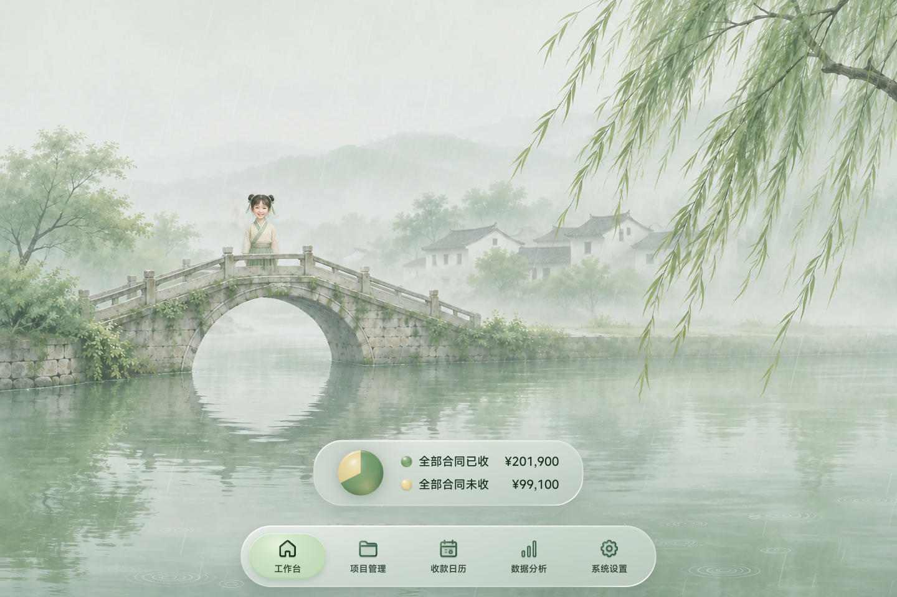
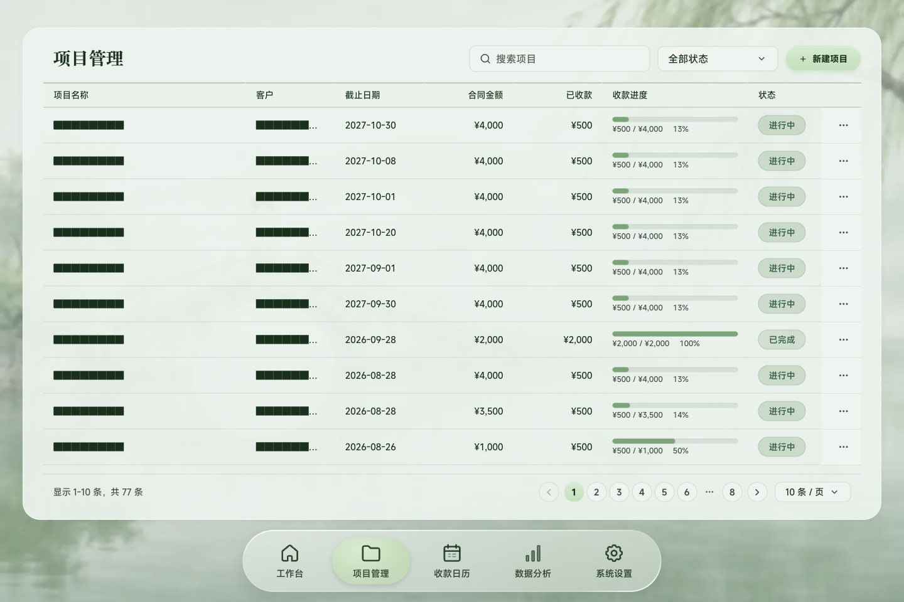

<div align="center">
  

# Zhusuan · 珠算

Desktop project ledger and payment tracking

[简体中文](README.md) · [Changelog](CHANGELOG.md) · [Migration](docs/migration.md) · [Release documentation](docs/release.md)

</div>

Zhusuan is a Wails, Go and React desktop app for project contracts, installment plans, receipts and overdue payments. The original Orange repository now belongs to [Primordial Weave](https://github.com/primordialweave/zhusuan). Current version: **1.0.2**. [Download packages](https://github.com/primordialweave/zhusuan/releases/tag/v1.0.2).

macOS downloads: [Apple Silicon DMG](https://github.com/primordialweave/zhusuan/releases/download/v1.0.2/zhusuan-v1.0.2-macOS-arm64.dmg) · [Intel DMG](https://github.com/primordialweave/zhusuan/releases/download/v1.0.2/zhusuan-v1.0.2-macOS-amd64.dmg). Drag Zhusuan into Applications and launch it from that folder.

## Features

- All-time, calendar-year and calendar-month payment summaries.
- Project/customer/contract records, dictionary-backed project types and collection progress.
- One-time and installment payments, receipt confirmation and payment calendar.
- Date-scoped analytics and CSV export through native save dialogs.
- Profile, dictionary, user, notification, data sync and appearance settings.
- OS credential storage and in-app verified download, installation and restart.
- Mist/night themes, celadon abacus icons and reduced-motion preferences.

## Screenshots

These current UI captures use an isolated database copy. Project/customer names, contract identifiers, people and contact information are redacted; monetary values are unchanged.

| Workbench | Projects |
| --- | --- |
|  |  |
| Calendar | Analytics |
|  |  |
| Dictionaries | About |
|  |  |

[Project detail](docs/screenshots/project-detail.png) · [Create project](docs/screenshots/project-create.png) · [Login](docs/screenshots/login.png)

## Stack and supported targets

Go 1.26.11 (minimum 1.26.10), Wails v3.1.0, Gin/GORM, React 19, TypeScript, Vite 8, React Router, Zustand, ODS/Tailwind 4 and Chart.js. SQLite is the desktop default; MySQL/PostgreSQL connections are configurable.

macOS, Windows and Linux are the current release-workflow targets. iOS/Android contain build scaffolding and icon assets, without completed mobile release acceptance.

## Development

Use Go 1.26.11 (minimum 1.26.10) and Node.js 24. The frontend engine range is defined in frontend/package.json. Linux desktop builds also need GTK3 and WebKit2GTK 4.1 development packages. macOS 12 or newer is required; Go 1.26 remains on its latest maintenance release to retain Monterey support.

```sh
git clone https://github.com/primordialweave/zhusuan.git
cd zhusuan
go install github.com/wailsapp/wails/v3/cmd/wails3@v3.1.0
go install github.com/go-task/task/v3/cmd/task@v3.54.0
cd frontend && npm ci && cd ..
task dev
```

`task build` builds the current platform; `task package` creates its distribution package (native-architecture DMG plus ZIP updater payload on macOS). Use `task darwin:package ARCH=arm64` or `ARCH=amd64` for Apple Silicon or Intel; `task darwin:package:app` creates only the app bundle. `task server:dev` starts the standalone HTTP server. Browser testing can use frontend/vite.preview.config.mts with an isolated backend/database. `task icons` regenerates platform icons from build/appicon.png.

## Storage and upgrade

The default directory is `UserConfigDir/primordialweave/zhusuan`, containing `zhusuan.db`. Fresh databases receive generated initial passwords in `initial-credentials.txt` (0600 permissions). Never use development example credentials in production.

On first launch, the legacy Orange database is copied using a consistent SQLite snapshot. The original is kept and existing new data is never overwritten. Explicit nonempty `DB_PATH` remains authoritative. Windows uses a new per-user installation directory and keeps the Orange installation. Launch Zhusuan once as the original user after installation to migrate default data. See [migration details](docs/migration.md).

Set a random production `JWT_SECRET` and restrict external API/metrics access. Logout clears local sessions; it is not a server-side immediate token revocation guarantee.

## Verification and release

```sh
cd frontend
node node_modules/eslint/bin/eslint.js src --max-warnings=0
npm run test:run
npm run build
cd ..
ZHUSUAN_CONFIG_ROOT=/tmp/zhusuan-check go test -race . ./internal/... ./cmd/...
go vet . ./internal/... ./cmd/...
python3 scripts/test_release.py
```

The release workflow builds and verifies all three targets before publishing a complete draft. Updates use update.json and SHA-256 verification. Native installation/UAC, older OS compatibility and restart/rollback acceptance limits are recorded in [release documentation](docs/release.md).

Contributions are welcome with relevant validation and redacted UI captures. Licensed under [MIT](LICENSE).
