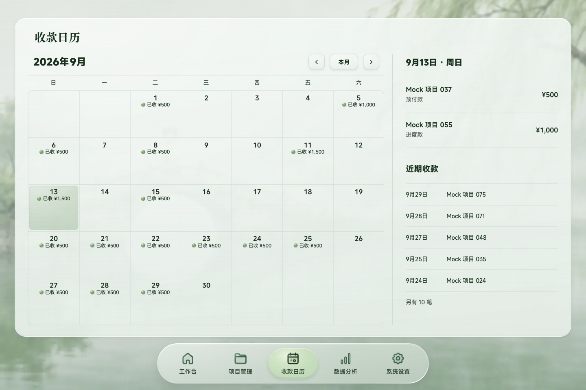
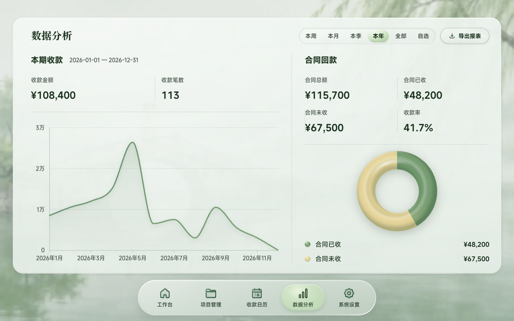
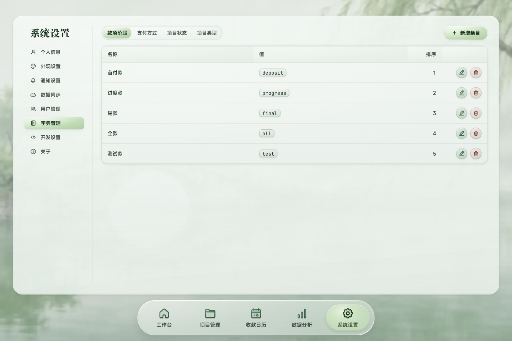
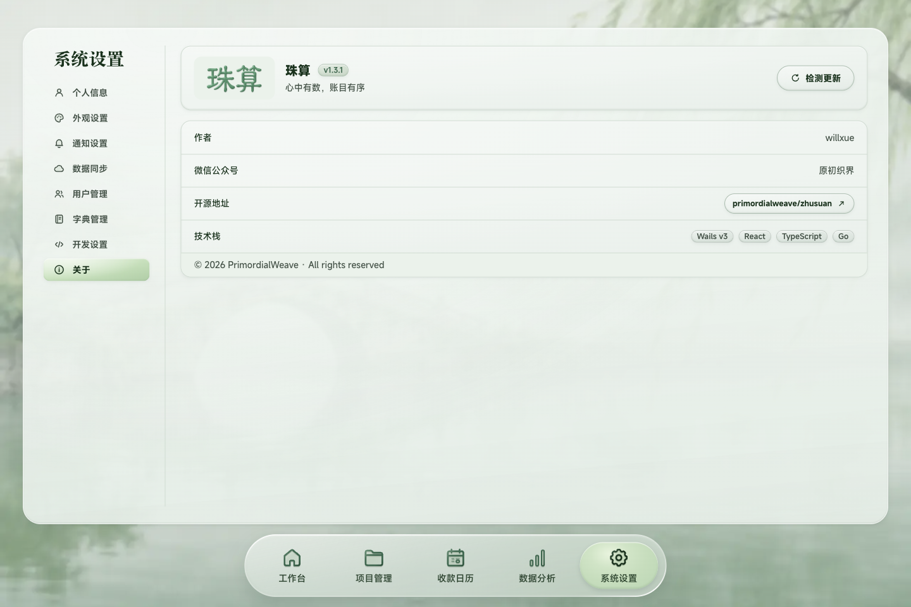

<div align="center">
  <picture>
    <source media="(prefers-color-scheme: dark)" srcset="docs/assets/readme-banner-dark.png" />
    <source media="(prefers-color-scheme: light)" srcset="docs/assets/readme-banner.png" />
    
  </picture>

  <p><strong>A clean, cross-platform desktop application for project ledgers and payment tracking</strong></p>

  <p>
    <a href="https://github.com/primordialweave/zhusuan/releases/tag/v1.3.0">
      
    </a>
    
    
    
    <a href="LICENSE">
      
    </a>
  </p>

  <p>
    <a href="README.md">简体中文</a> ·
    <a href="https://github.com/primordialweave/zhusuan/releases/tag/v1.3.0">Downloads</a> ·
    <a href="CHANGELOG.md">Changelog</a> ·
    <a href="docs/migration.md">Migration</a> ·
    <a href="docs/release.md">Release Notes</a>
  </p>
</div>

---

## Features

- **Workbench**: Click to switch all contracts, contracts signed this year, or contracts signed this month, and view their current collected and outstanding amounts.
- **Project Ledger**: Manage clients, contract totals, project categories, delivery dates, and payment completion progress.
- **Receipts & Calendar**: Create a project before receiving payment, then record each receipt with its actual date; the calendar displays actual receipts and retains historical plan data.
- **Analytics & Export**: Contract balances by signing date for natural periods or custom months/years, independent cash receipt trends, and CSV export via native save dialogs.
- **Administration**: Profile, dictionaries, users, notifications, cloud data sync, and appearance preferences.
- **Native Desktop Experience**: Light/dark themes, live light/dark/system macOS icon selection, OS keychain credential storage, and verified in-app updates.

## Screenshots

| Workbench | Projects |
| --- | --- |
|  |  |
| **Calendar** | **Analytics** |
|  |  |
| **Dictionaries** | **About** |
|  |  |

More views: [Project detail](docs/screenshots/project-detail.png) · [Create project](docs/screenshots/project-create.png) · [Login](docs/screenshots/login.png)

## Downloads

Download the latest **v1.3.0** packages from [GitHub Releases](https://github.com/primordialweave/zhusuan/releases/tag/v1.3.0):

| Platform | Package | Notes |
| --- | --- | --- |
| macOS (Apple Silicon) | [zhusuan-v1.3.0-macOS-arm64.dmg](https://github.com/primordialweave/zhusuan/releases/download/v1.3.0/zhusuan-v1.3.0-macOS-arm64.dmg) | Apple Silicon, macOS 12+ |
| macOS (Intel) | [zhusuan-v1.3.0-macOS-amd64.dmg](https://github.com/primordialweave/zhusuan/releases/download/v1.3.0/zhusuan-v1.3.0-macOS-amd64.dmg) | Intel, macOS 12+ |
| Windows (x64) | [zhusuan-v1.3.0-windows-amd64-installer.exe](https://github.com/primordialweave/zhusuan/releases/download/v1.3.0/zhusuan-v1.3.0-windows-amd64-installer.exe) | Per-user installer & upgrade |
| Linux (x64) | [AppImage](https://github.com/primordialweave/zhusuan/releases/download/v1.3.0/zhusuan-v1.3.0-linux-x86_64.AppImage) · [.deb](https://github.com/primordialweave/zhusuan/releases/download/v1.3.0/zhusuan-v1.3.0-linux-amd64.deb) · [.rpm](https://github.com/primordialweave/zhusuan/releases/download/v1.3.0/zhusuan-v1.3.0-linux-amd64.rpm) | Portable & native packages |

> On macOS, open the DMG, drag Zhusuan into `Applications`, and launch it from there.

## Tech Stack

| Layer | Technologies |
| --- | --- |
| Desktop | Wails v3.1, native OS WebView |
| Backend | Go 1.26, Gin, GORM, SQLite (default) / MySQL / PostgreSQL |
| Frontend | React 19, TypeScript, Vite 8, React Router, Zustand |
| Design & Charts | ODS design system & semantic tokens, JadeIcon SVG, Tailwind CSS 4, Chart.js |

## Getting Started

### Prerequisites

- Go `1.26.10+` (`1.26.11` recommended)
- Node.js `24+` and npm
- Wails CLI `v3.1.0` and Task `v3.54.0`
- Linux desktop builds also require GTK4 and WebKitGTK 6.0 development packages

### Local Development

```sh
git clone https://github.com/primordialweave/zhusuan.git
cd zhusuan
go install github.com/wailsapp/wails/v3/cmd/wails3@v3.1.0
go install github.com/go-task/task/v3/cmd/task@v3.54.0
cd frontend && npm ci && cd ..
task dev
```

### Common Tasks

| Command | Description |
| --- | --- |
| `task dev` | Start Wails desktop development mode |
| `task build` | Build the application for the current platform |
| `task package` | Create distribution packages for the current platform |
| `task darwin:package ARCH=arm64` | Build macOS DMG and updater ZIP (`arm64` or `amd64`) |
| `task server:dev` | Run the standalone HTTP API server |
| `task icons` | Regenerate all platform icons from `build/appicon.png` and `build/appicon-dark.png` |

## Configuration & Data Directory

Default configuration and database directory (`zhusuan.db`):

- **macOS**: `~/Library/Application Support/primordialweave/zhusuan`
- **Windows**: `%APPDATA%\primordialweave\zhusuan`
- **Linux**: `~/.config/primordialweave/zhusuan`

Fresh databases receive a randomly generated initial admin password written to `initial-credentials.txt` (`0600` permissions) in the data directory. For legacy Orange data migration, see [Migration Guide](docs/migration.md).

Runtime options can be configured via `.env` (see `.env.example`):

| Variable | Description |
| --- | --- |
| `DB_TYPE` / `DB_PATH` | Database driver (`sqlite` / `mysql` / `postgres`) and custom path |
| `API_SERVER_PORT` | Standalone HTTP server port |
| `JWT_SECRET` | JWT signing secret (use a strong random value in production) |
| `GITHUB_REPO` | Repository used for in-app update checks |
| `APP_SLOGAN` | About page tagline (defaults to `心中有数，账目有序`; takes effect on restart) |
| `APP_WECHAT_PUBLIC_ACCOUNT` | About page WeChat public account name (defaults to `原初织界`; takes effect on restart) |

## Verification

```sh
# Frontend lint, tests, and production build
cd frontend
node node_modules/eslint/bin/eslint.js src --max-warnings=0
npm run test:run
npm run build
cd ..

# Backend and release script checks
ZHUSUAN_CONFIG_ROOT=/tmp/zhusuan-check go test -race . ./internal/... ./cmd/...
go vet . ./internal/... ./cmd/...
python3 -m unittest discover -s scripts -p "test_*.py"
```

## Contributing & License

Issues and pull requests are welcome. Please include relevant tests and build verification with your changes. Licensed under the [MIT License](LICENSE).
