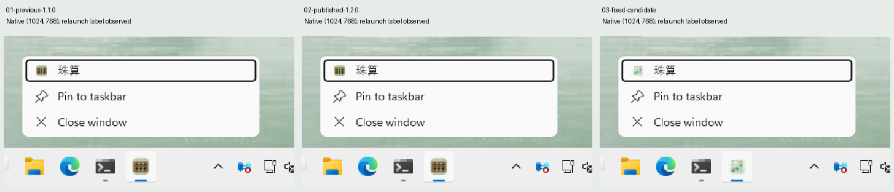

# Windows 升级后的图标与任务栏名称

用户报告从 v1.1.0 升级到 v1.2.0 后桌面图标仍旧、任务栏右键名称乱码。本次修复针对 Windows 安装器的 Shell 刷新和版本资源消费者兼容性。

## 改动

- 为每个版本安装独立的 `zhusuan-shortcut-<version>.ico`，桌面与开始菜单快捷方式显式指定该文件、索引 0 和 Unicode 描述「珠算」。安装成功后向 EXE 和两个快捷方式发送 `SHCNE_UPDATEITEM / SHCNF_PATHW|FLUSH`；没有清理全局图标缓存或重启 Explorer。
- 图标、程序、卸载器和快捷方式替换有备份和回滚。快捷方式创建在注册表写入前完成，锁定快捷方式时不会把旧安装的注册路径改成失败的新目标。仅退休与旧注册图标路径严格匹配的已管理图标，保留其他 ICO。
- 补充 `StringFileInfo.FileVersion` 和 `VS_FIXEDFILEINFO.product_version`，版本同步脚本同时更新四个版本位置。原 UTF-16 中文字节正确，但 .NET FileVersionInfo 只有 FileVersion 字符串非空时才接受首个翻译表；缺失时后备查询把正确名称覆盖为空。中性语言表本身有效，不改框架和应用身份。

## 原生验收

应用/安装器来自提交 `eb91727731feb09f5120761b72de10b2c07d1833`，完整 Windows 构建、普通用户安装、升级回滚、窗口及后端步骤在 run `44976588358` 通过；该 run 的早期任务栏探针仍失败，不能称整轮成功。

最终 [Windows 检查 44982162466](https://github.com/primordialweave/zhusuan/actions/runs/44982162466) 使用同一安装器，只替换验证脚本（`a675d6c`）；所有原生安装/升级/任务栏步骤通过，未重建应用。验证包括：

- 真实安装旧 v1.1.0，在同一目录升级，桌面与开始菜单的 Shell 图像从旧图切为新图。比较使用独立新 ICO 的参考快捷方式，完整像素一致，包含正常快捷方式箭头。
- 显式自定义路径、普通及机器安装、锁定程序/快捷方式回滚、A→B 失败移动的完整旧注册值（名称、类型、原始值及缺失字段）和原程序/链接哈希保持不变。
- 旧1.1→公开1.2→修复候选三阶段同路径、真实右键与实际 UIA 操作行全部显示「珠算」。候选 Windows/.NET ProductName、FileDescription、FileVersion、ProductVersion 正确，数值产品版本为1.2.0.0。私有测试数据和安装已清理，未在用户机器执行安装。

公开1.2基线截图仍显示同路径缓存的旧任务栏/菜单图标；候选显示新的玉质图标。两段干净基线的菜单名称已经正确，因此**没有直接复现用户截图的乱码，也不宣称找到其唯一原因**。候选的兼容性修复与实际中文名称均已验证；已有损坏的用户 Shell 状态仍需该用户安装新包后确认。

## 证据与交付状态

机器记录：[windows-upgrade-shell-verification.json](windows-upgrade-shell-verification.json)。全部失败日志、未放松的断言及最终截图在 `/tmp/zhusuan-windows-shell-fix`。早期失败包括裸 ICO 与快捷方式箭头的比较假阴性、缺少 FileVersion 的基线消费字段、ShellExperienceHost 弹层不在 Explorer 树、UIA 命中别名和首次右键未打开；最终验收保留真正的窗口/菜单约束。

修复在 `codex/windows-shell-fix`，公开 v1.2.0 标签及附件没有覆盖。预览安装器 SHA256 为 `33dcc05e78879260ef9fb17ebda8a43ea2ac0fcd6613ade1a1aef7eec5216a86`，尚未作为新正式版本发布。当前主 checkout 有其他会话的项目/收款/日期改动；本验收只覆盖独立 Windows 快照，不等同于验证整个主工作区。
